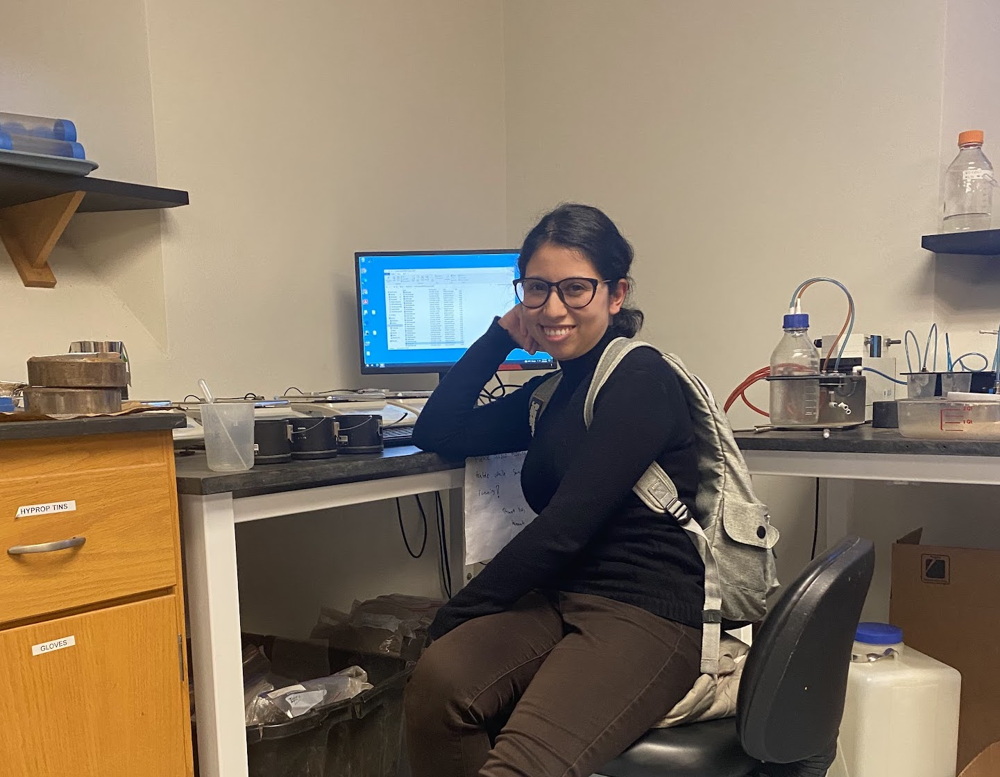
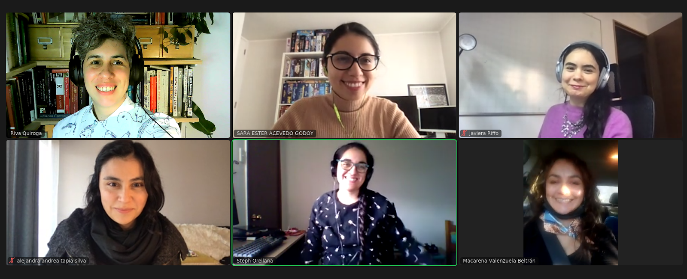
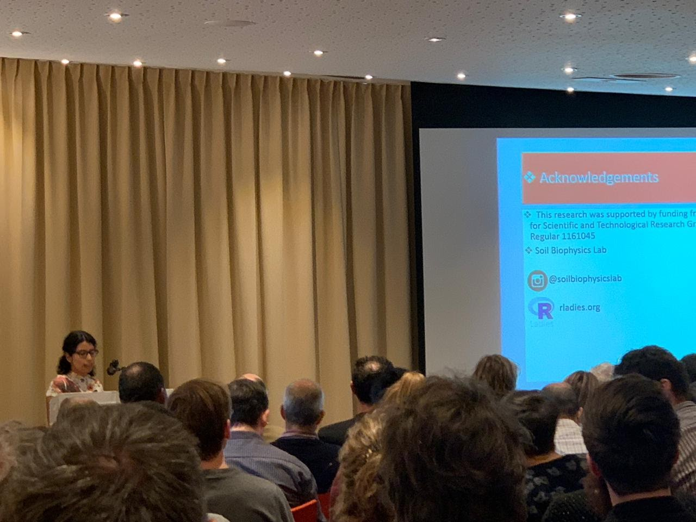
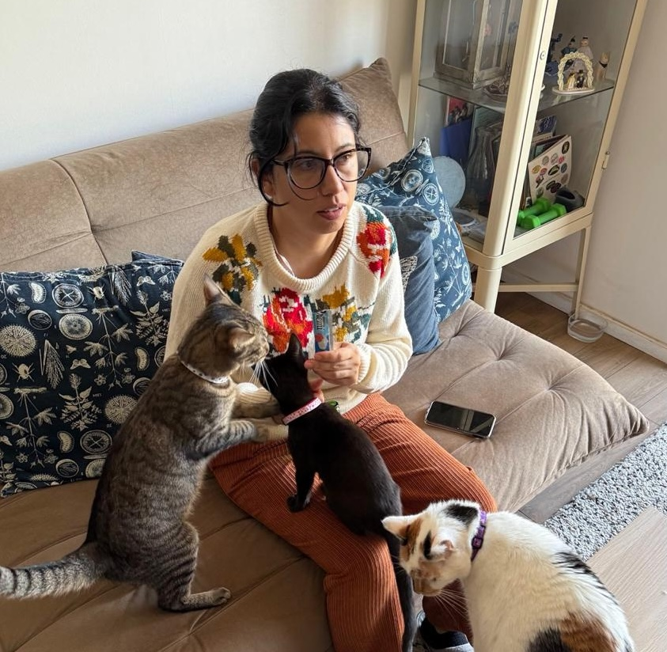

```{=html}
<style>
.demo{border:2px solid #40666e;border-radius:12px;padding:14px 18px;margin-top:12px;font-size:0.55em;background:#f7fafa}
.demo h4{margin:0 0 8px 0;color:#40666e;font-size:1.1em}
.demo button{font-size:0.9em;margin:3px;padding:4px 10px;border-radius:8px;border:1px solid #40666e;background:white;cursor:pointer}
.demo button:hover{background:#40666e;color:white}
.demo .frase{font-family:monospace;font-size:1.15em;margin:8px 0;min-height:1.5em}
.demo .chip{display:inline-block;padding:2px 6px;margin:2px;border-radius:6px;font-family:monospace}
.demo input{font-size:1em;width:95%;padding:4px}
.demo .nota{font-size:0.85em;color:#555;margin-top:6px}
</style>
```

## Acerca de mi 👩🏽‍💻
::::: {.columns style="text-align:center;margin-top:50px;"}

:::: {.column width="50%" style="margin-top:50px"}
::: {.r-stack}
{.fragment .fade-in-then-semi-out fragment-index=1 style="width:70%;transform:rotate(-5deg);" fig-alt="lab"}

{.fragment .fade-in-then-semi-out fragment-index=2 style="transform:rotate(5deg);" fig-alt="rladies"}

{.fragment .fade-in fragment-index=3 style="transform:rotate(-1deg);" fig-alt="wageningen"}
:::
::::

:::: {.column width="50%"  style="margin-top:25px"}
::: {.fragment fragment-index=1}
Profesora Asistente Facultad de Agronomía y Sistemas Naturales
:::
::: {.fragment fragment-index=2}
Parte de RLadies Santiago y RSE-Chile 
:::
::: {.fragment fragment-index=3}
Investigadora CEDEUS
:::
::::

:::::

## Dos verdades y una mentira 👩🏽‍💻
::::: {.columns style="text-align:center;margin-top:50px;"}

:::: {.column width="50%" style="margin-top:50px"}
::: {.r-stack}
{.fragment .fade-in-then-semi-out fragment-index=1 style="width:50
0%;transform:rotate(-5deg);" fig-alt="lab"}

{.fragment .fade-in-then-semi-out fragment-index=2 style="transform:rotate(5deg);" fig-alt="rladies"}

{.fragment .fade-in fragment-index=3 style="transform:rotate(-1deg);" fig-alt="italia}
:::
::::

:::: {.column width="50%"  style="margin-top:25px"}
::: {.fragment fragment-index=1}
Me encantan los gatos
:::
::: {.fragment fragment-index=2}
Me causa un poco de rechazo la IA en la investigación
:::
::: {.fragment fragment-index=3}
Nunca he visitado Italia
:::
::::

:::::


# [Veamos unas cosas antes del taller]{.r-fit-text} {background-color="#40666e"}

## Uso responsable de la IA en investigación

::: {.incremental}

1. El código generado por IA puede tener más defectos que el humano. *Si no entiendes cómo funciona, no podrás arreglarlo cuando falle*

2. La IA puede reproducir código de otros sin citarlos. Hay demandas contra GitHub Copilot por los datos con que fue entrenado.

3. Se puede exponer información privada y violar leyes de protección de datos. Además, entrenar y usar estos modelos consume mucha energía.

:::

::: aside
Fuente: [Responsible use of AI in research software](https://www.software.ac.uk/guide/responsible-use-ai-research-software). Software Sustainability Institute (2026).
:::

## Cómo usar la IA de forma responsable

::: {.incremental}

1. El trabajo pasa de escribir código a revisarlo. Todo código generado se revisa y se prueba; el *vibe coding* queda solo para proyectos personales o de bajo riesgo.

2. Declarar dónde y cómo se usó la IA, en el README, en los scripts y en los manuscritos.

3. La autora responde por su software y sus resultados, aunque lo haya escrito una IA. Documentar bien facilita validar y reutilizar el trabajo.

:::

::: aside
Fuente: [Responsible use of AI in research software](https://www.software.ac.uk/guide/responsible-use-ai-research-software). Software Sustainability Institute (2026).
:::

## ¿Qué es un LLM?

::: {.incremental}
1. **Predice la siguiente palabra** más probable, una y otra vez, hasta armar la respuesta.
2. **No busca la respuesta** en una base de datos ni en internet por defecto: la construye por probabilidad.
3. Aprendió **patrones** de enormes cantidades de texto, como quien reconoce un salón a oscuras porque ha visto miles.
:::

```{=html}
<div class="demo" id="demo-llm">
  <h4>🎲 Predecir la siguiente palabra</h4>
  <div class="frase" id="llm-frase">Para visualizar datos en R uso</div>
  <div id="llm-opciones"></div>
  <button onclick="llmReset()">↺ Reiniciar</button>
  <div class="nota" id="llm-nota"></div>
</div>
<script>
(function(){
  const pasos = [
    [["ggplot2",0.64],["la",0.18],["Excel",0.12],["una cuchara",0.01]],
    [["porque",0.45],["con",0.30],["y",0.20],["bailando",0.01]],
    [["es flexible.",0.55],["tiene capas.",0.35],["sí.",0.08],["llueve.",0.02]]
  ];
  let i = 0;
  const base = "Para visualizar datos en R uso";
  function pintar(){
    const cont = document.getElementById("llm-opciones");
    cont.innerHTML = "";
    if(i >= pasos.length){
      document.getElementById("llm-nota").textContent =
        "El modelo no 'sabe' qué usas: elige lo que suena más probable según lo que leyó.";
      return;
    }
    pasos[i].forEach(([w,p]) => {
      const b = document.createElement("button");
      b.textContent = w + " (" + Math.round(p*100) + "%)";
      b.onclick = () => {
        document.getElementById("llm-frase").textContent += " " + w;
        if(p < 0.05) document.getElementById("llm-nota").textContent =
          "Elegiste algo improbable: posible, pero el modelo casi nunca lo diría.";
        i++; pintar();
      };
      cont.appendChild(b);
    });
  }
  window.llmReset = function(){
    i = 0;
    document.getElementById("llm-frase").textContent = base;
    document.getElementById("llm-nota").textContent = "";
    pintar();
  };
  pintar();
})();
</script>
```

::: aside
Fuente: [Martínez-González, E. (2026). *Introducción a los LLMs*](https://eduard-martinez.github.io/teaching/ba/lectures/week-02/theory/week-02.html).
:::

## ¿Qué es un token?

::: {.incremental}
1. Es la pieza mínima que procesa el modelo: una palabra, un pedazo de palabra o un signo.
2. Se cobra por token, y los de salida cuestan más que los de entrada.
3. En general, el español usa más tokens que el inglés.
:::

```{=html}
<div class="demo" id="demo-tok">
  <h4>🧮 Escribe y mira los tokens (estimación)</h4>
  <input id="tok-input" value="La visualización de datos ayuda a tomar decisiones." oninput="tokPintar()">
  <div class="frase" id="tok-salida"></div>
  <div class="nota" id="tok-cuenta"></div>
</div>
<script>
(function(){
  const colores = ["#cfe8e4","#f6d8b8","#d8d0f0","#f2c4cf","#d4ecbf"];
  function partir(palabra){
    const conTilde = /[áéíóúñ]/i.test(palabra);
    if(palabra.length <= 5 && !conTilde) return [palabra];
    const trozos = [];
    for(let k = 0; k < palabra.length; k += 4) trozos.push(palabra.slice(k, k+4));
    return trozos;
  }
  window.tokPintar = function(){
    const txt = document.getElementById("tok-input").value;
    const piezas = (txt.match(/[\wáéíóúñÁÉÍÓÚÑ]+|[^\s\w]/g) || []).flatMap(partir);
    const out = document.getElementById("tok-salida");
    out.innerHTML = "";
    piezas.forEach((p,j) => {
      const s = document.createElement("span");
      s.className = "chip"; s.textContent = p;
      s.style.background = colores[j % colores.length];
      out.appendChild(s);
    });
    const palabras = (txt.match(/\S+/g) || []).length;
    document.getElementById("tok-cuenta").textContent =
      palabras + " palabras → ~" + piezas.length + " tokens.";
  };
  tokPintar();
})();
</script>
```

::: aside
Fuente: [Martínez-González, E. (2026). *Introducción a los LLMs*](https://eduard-martinez.github.io/teaching/ba/lectures/week-02/theory/week-02.html). El conteo de la demo es una aproximación.
:::

## ¿Qué es un prompt?

Un **prompt** es la instrucción que le damos al modelo: la tarea, el contexto y el formato en que esperamos la respuesta.

::: {.incremental}
1. Ser claro y directo: si una persona sin contexto no entendería tu prompt, el modelo tampoco. "Haz un gráfico de barras horizontales con los km de ciclovía por comuna, ordenado de mayor a menor" funciona mejor que "Grafica los datos".
2. Explicar el por qué: dar la razón detrás ayuda al modelo a entender qué buscas."Usa letra grande, porque el gráfico se proyectará en una sala" funciona mejor que solo "usa letra grande".

:::

::: aside
Fuente: [Anthropic. *Prompting best practices*](https://platform.claude.com/docs/en/build-with-claude/prompt-engineering/be-clear-and-direct).
:::

## ¿Qué es un prompt?

Un **prompt** es la instrucción que le damos al modelo: la tarea, el contexto y el formato en que esperamos la respuesta.

::: {.incremental}
3. Dar ejemplos y un rol: 3 a 5 ejemplos variados mejoran la precisión; una frase como "Eres experta en ggplot2" orienta las respuestas.
4. Decir qué hacer, no qué evitar: “Usa la paleta viridis, apta para daltonismo” funciona mejor que “No uses rojo y verde”.
:::

::: aside
Fuente: [Anthropic. *Prompting best practices*](https://platform.claude.com/docs/en/build-with-claude/prompt-engineering/be-clear-and-direct).
:::

## ¿Mis datos son privados? 🔒 Pero quiero usar IA!

::: {.incremental}
1. **Lo que pegas en un chat sale de tu computador** y deja de estar bajo tu control.
2. **La IA no necesita tus datos reales:** le basta con conocer su **estructura**, es decir, los nombres de las columnas, los tipos de datos y algunos valores de ejemplo.
3. **Crea datos sintéticos:** una base falsa, pequeña y con la misma estructura. Así el código que te devuelva la IA funcionará con tus datos reales sin cambios.
:::

::: aside
Fuente: [UBC Library Research Commons (2025). *Coding with ChatGPT*](https://ubc-library-rc.github.io/AI_for_coding_2025/content/4_Code_Build_Practice.html).
:::

## Datos sintéticos en la práctica

```{r}
#| echo: true
#| eval: false
library(tidyverse)

# 1. Mira la estructura de tus datos reales (esto NO se comparte)
glimpse(datos_reales)

# 2. Crea una base sintética con las mismas columnas y tipos
set.seed(123)
datos_sinteticos <- tibble(
  comuna    = sample(c("Santiago", "Maipú", "Ñuñoa"), 30, replace = TRUE),
  edad      = sample(18:80, 30, replace = TRUE),
  ingreso   = round(rnorm(30, mean = 800000, sd = 200000)),
  satisfecho = sample(c("Sí", "No"), 30, replace = TRUE)
)

# 3. Comparte solo esto con la IA
glimpse(datos_sinteticos)
```

## Ejemplo de prompt

**Prompt:** "Tengo una base con esta estructura: [pega el `glimpse()`]. Escribe código ggplot2 para comparar el ingreso por comuna."


::: aside
Fuente: [UBC Library Research Commons (2025). *Coding with ChatGPT*](https://ubc-library-rc.github.io/AI_for_coding_2025/content/4_Code_Build_Practice.html).
:::

## Donde contactarme 👩🏽‍💻

-   En instagram: *soilbiophysicsgirls*
-   Web: saryace.github.io

# [Ahora el Taller 👩🏽‍💻]{.r-fit-text style="color: white; font-size: 150px; background-color:#40666e;"} {background-color="#40666e"}

## Repositorio del taller

[github.com/Saryace/ia-generativa-wids](github.com/Saryace/ia-generativa-wids)
